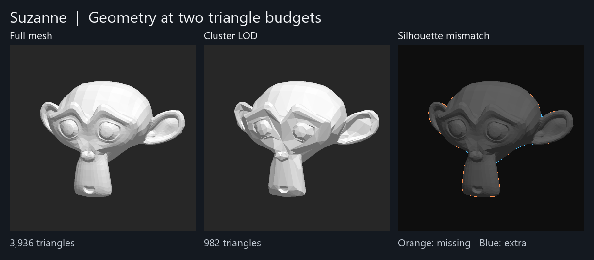

# ManyMesh

ManyMesh is a mesh level-of-detail research prototype built in the Filament
repository. It measures image quality and rendering cost for simplified
geometry. **No SIGGRAPH-ready method or mobile-performance claim is established.**

## Research question

Can offline fitting improve a constrained cluster-LOD mesh after the same
antialiasing or upscaling pipeline used by its controls, at matched face count
and complete cost? This remains unproven; see the [current research status](MANYMESH.md)
and [prior-art audit](docs/manymesh/siggraph-prior-art-screen-20261123.md).

*Illustrative fixed-view CPU render: 3,936-triangle source versus a 982-triangle,
8-cluster meshoptimizer cut, 384 × 384, orthographic, 4 samples per pixel.
Asset: UX3D / Norbert Nopper, Khronos glTF Sample Assets, CC0 1.0. This is not
a held-out benchmark; see the [figure receipt](docs/manymesh/suzanne-lod.json).*

## Evidence snapshot

| Finding | Scope and conditions |
|---|---|
| **−2.27 dB PSNR** for ManyMesh versus meshoptimizer | Mean paired delta; 95% source-family group-bootstrap CI [−2.69, −1.83]. 21 Poly Haven models, exact 50% face retention, 24 view-distance pairs per model, native sampling at 640 × 360 on Intel Iris Xe / D3D12. The full source mesh is the reference. |
| **31.0% → 16.3%** of squared grayscale error inside silhouette-XOR pixels | Same 21-model, 24-view cohort: native sampling versus 4× MSAA. This is a post-hoc geometric diagnostic, not a perceptual score; MSAA also reduces error outside the contour mask. |
| **26.155 ms → 6.657 ms** raster interval at 10,000 instances | A standard meshoptimizer cut on one BarramundiFish asset, 1280 × 720, 4× MSAA, Intel Iris Xe / D3D12. This is a single-view raster-only desktop result, not a ManyMesh or full-frame win. |

The 21-model screen reports LDR-FLIP, PSNR, SSIM, silhouette XOR, sampled
surface distance, and normal agreement. Its post-hoc LPIPS supplement uses the
same cohort. Those controls beat the tested ManyMesh cuts; details and
uncertainty are in the [quality report](tools/mmtrain/POLYHAVEN_QUALITY_SCREEN_20261124.md),
[silhouette analysis](tools/mmtrain/POLYHAVEN_SILHOUETTE_ATTRIBUTION_20261125.md),
and [instance-scale report](tools/mmtrain/INSTANCE_SCALE_BARRAMUNDIFISH_SCREEN_20261125.md).

## Evidence status

| Works in measured scope | Does not work in tested scope | Not measured |
|---|---|---|
| CPU quality and topology evaluation; fixed-view desktop comparisons; one raster-only 10,000-instance diagnostic. | Current ManyMesh cuts lose to matched-face QEM and meshoptimizer. Tested decoders, contour controls, and CPU projective-silhouette fitting have no repeatable matched-control win. | Physical-phone performance, power, equal-complete-frame-time MSAA/SMAA/upscaler comparison, an asset-held-out optimization win, user preference, and a validated temporal-quality gain. |

## Local verification

On the D-drive WSL2 Ubuntu build, `test_manymesh` passed 94 of 95 tests; one
was skipped. Vulkan `compute_test` passed 7/7 on the CPU llvmpipe software
device. Software OpenGL aborted in three tests, and the Iris Xe route skipped
all seven because it exposed only Filament feature level 1. Hardware GPU compute
therefore remains unverified. See the [local verification receipt](tools/mmtrain/LOCAL_WORKSTATION_VERIFICATION_20261126.md).

The full RGB fitting workflow produced artifacts for two reused assets, but
its metrics have not been independently audited. The separate frozen CUDA
placement control has not run. Neither result is a quality-gate pass; see the
[experiment gate](MANYMESH_NEXT_EXPERIMENT_GATE.md) and [RGB fitting protocol](tools/mmtrain/PROJECTIVE_RGB_CPU_PROTOCOL_20261125.md).

## Research index

- [Current status and next gate](MANYMESH.md)
- [SIGGRAPH 2027 direction](SIGGRAPH_2027_DIRECTION.md)
- [Research roadmap](MANYMESH_RESEARCH_ROADMAP.md)
- [Dated experiment history](MANYMESH_HISTORY.md)
- [Learned-LOD research](MANYMESH_LEARNED_LOD_RESEARCH.md)
- [Filament documentation](filament/README.md)
