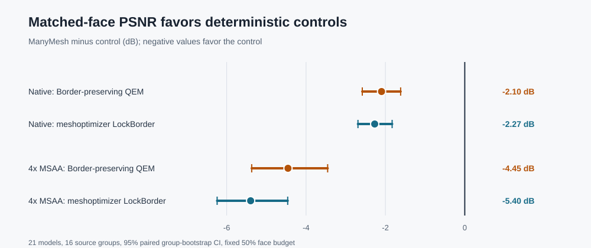

# ManyMesh

ManyMesh is a Filament-based research prototype for mesh level of detail
(LOD). It studies the image quality and cost of simplified geometry.
**No SIGGRAPH-ready method or mobile-performance result is established.**

The current 21-model, matched-face screen found that the tested ManyMesh cuts
lost to QEM and meshoptimizer on every reported image metric, both with native
sampling and 4x MSAA. The current research question is whether a specific final
reconstruction pipeline can change that result under legal cluster-DAG
constraints. This is untested and has close prior art.

## The open problem

One fixed 960x720 Monkey view at 45.25% retention measured silhouette XOR at
0.11% of pixels and 68.3% of squared error, but used an 11,250-face DAG cut as
the reference rather than the 15,744-face source mesh. A later eight-view
diagnostic uses the original source and checked-in candidate meshes:
silhouette-XOR pixels account for 34.75%, 25.84%, and 25.88% of squared image
error at 30%, 50%, and 70% retention. At all three budgets the candidate loses
to eligible exact-face QEM and/or meshoptimizer controls on the reported image
metrics. This remains a single-asset exploratory result: its boundary tolerance
was selected retrospectively, the candidate generator binary is unpinned, and
it is not held-out evidence. See the [protocol and results](tools/mmtrain/MONKEY_SOURCE_REFERENCE_DIAGNOSTIC_20261125.md)
and [machine-readable receipt](tools/mmtrain/monkey_source_reference_diagnostic_20261125/receipt.json).
These measurements do not establish a general silhouette-error share.
Silhouette error is important, but its share depends on view and reference;
contour-weighted geometry has not shown a repeatable quality/cost win, and
antialiasing remains a strong baseline. The open question is whether offline
geometry optimization improves image quality after the same AA or upscaler at
matched face count and complete cost, while preserving cluster boundaries and
topology. Report LDR-FLIP, PSNR, SSIM, silhouette, surface, and topology metrics
together. See the [historical decomposition](MANYMESH_HISTORY.md#fixed-camera-4525-error-decomposition),
[source-reference follow-up](MANYMESH_HISTORY.md#12-2026-11-23-original-source-and-asset-feasibility-follow-up),
and [research status](MANYMESH.md).

*ManyMesh minus each control across 21 models at matched face counts; negative
values favor the control. Bars show 95% bootstrap intervals over 16 source
collection groups. Data: [per-view metrics](tools/mmtrain/polyhaven_quality_metrics_20261124.json),
[protocol](tools/mmtrain/POLYHAVEN_QUALITY_SCREEN_20261124.md).*

## Evidence status

| Works in measured scope | Does not pass | Not measured |
|---|---|---|
| Fixed-view desktop image-quality screens and topology/boundary audits; a separate moving-camera LPIPS/temporal diagnostic. | The tested ManyMesh cut does not beat matched QEM or meshoptimizer controls on the frozen 21-model cohort. | Physical-phone performance, power, equal-frame-time quality, LPIPS on the matched-face cohort, user preference, and a held-out optimized method with a validated temporal-quality gain. |

The separate moving-camera screen uses three reused synthetic scenes. It
reports LPIPS and temporal metrics but finds no equal-time quality gain; see
the [measurement report](tools/mmmetrics/MOVING_SCENE_EDGE_QUALITY_20261124.md).

The 21-model result is fixed-view Iris Xe evidence, not mobile or equal-time
evidence. The earlier seven-asset Khronos screen used a retrospective boundary
tolerance and reused development assets; it beat meshoptimizer on two pairs
from one asset and beat no eligible QEM pair. [Research status and reports](MANYMESH.md).

A fresh Poly Haven cohort is now reserved for confirmation: 30 eligible models
across 25 source families and nine categories. It has not been image-scored;
see the [pool protocol and manifest](tools/mmtrain/POLYHAVEN_CONFIRMATION_POOL_20261125.md).
Retained compiler checksums resolve the archived executable's source set:
`main.cpp` matches the Khronos receipt, while `Simplifier.cpp` and
`Simplifier.h` match the Poly Haven pin. A clean Release rebuild from the
reconstructed source commit matches every PE byte except the duplicated build
timestamp fields; `.text` is identical. `Grouper.cpp` lacks an individual
retained source checksum, and the rebuilt executable was not run because
Windows application control blocked it. The archived executable replayed 18
expanded-cohort candidate meshes byte-for-byte at the recorded face counts;
the initial three were not replayed. See the [clean rebuild receipt](tools/mmtrain/mmgeo_clean_rebuild_489_20261125.json),
[compiled-source audit](tools/mmtrain/mmgeo_compiled_source_audit_20261125.json),
[rebuild verifier](tools/mmtrain/verify_mmgeo_clean_rebuild_489_20261125.py),
and [geometry replay receipt](tools/mmtrain/polyhaven_geometry_replay_20261125.json).

A separate fixed-view desktop stress test rendered 10,000 instances of five
pinned Khronos assets on Intel Iris Xe / D3D12 at 1280 x 720 with 4x MSAA and
no culling. A fixed depth-2 meshoptimizer cut submitted 9.024M rather than
36.148M triangles and reduced the GPU raster interval from 29.001 ms to
6.734 ms (4.31x), with a -0.190 dB PSNR change against the supersampled full-
source reference. The receipt also shows that the mixed-scene cut is not a
strictly eligible geometry comparison: four assets have changed boundary-edge
counts, and the CesiumMilkTruck cut has one duplicate face and two nonmanifold
edges. Treat its image-quality delta as diagnostic only; the raster timing
applies to the submitted buffers. This is not dynamic ManyMesh selection, a
full-frame timing, or mobile evidence. See the [topology caveat, protocol, and
repeated results](tools/mmtrain/INSTANCE_SCALE_SCREEN_20261124.md) and
[raw receipt](tools/mmtrain/instance_scale_20261124.json).

A topology-clean, single-asset follow-up repeated BarramundiFish at the same
instance counts. At 10,000 instances, stock depth-2 geometry reduced the GPU
raster p50 from 26.15 ms to 6.66 ms (3.93x), with -0.015 dB PSNR and +0.00013
LDR-FLIP deltas against the supersampled full-source reference. Bidirectional
sampled surface distance averages about 0.098% of the source bounding-box
diagonal, with mean normal differences of 6.8-7.1 degrees. This remains a
fixed-view desktop diagnostic at unequal face counts, not a held-out or
full-frame result. See the [protocol and results](tools/mmtrain/INSTANCE_SCALE_BARRAMUNDIFISH_SCREEN_20261125.md)
and [raw run receipts](tools/mmtrain/instance_scale_barramundifish_20261125_a.json)
and [run B](tools/mmtrain/instance_scale_barramundifish_20261125_b.json).

## Research documents

- [Current status and next decision](MANYMESH.md)
- [SIGGRAPH 2027 research direction](SIGGRAPH_2027_DIRECTION.md)
- [Next experiment gate](MANYMESH_NEXT_EXPERIMENT_GATE.md)
- [Prior-art screen](docs/manymesh/siggraph-prior-art-screen-20261123.md)
- [Dated experiment history](MANYMESH_HISTORY.md)
- [Filament documentation](filament/README.md)
