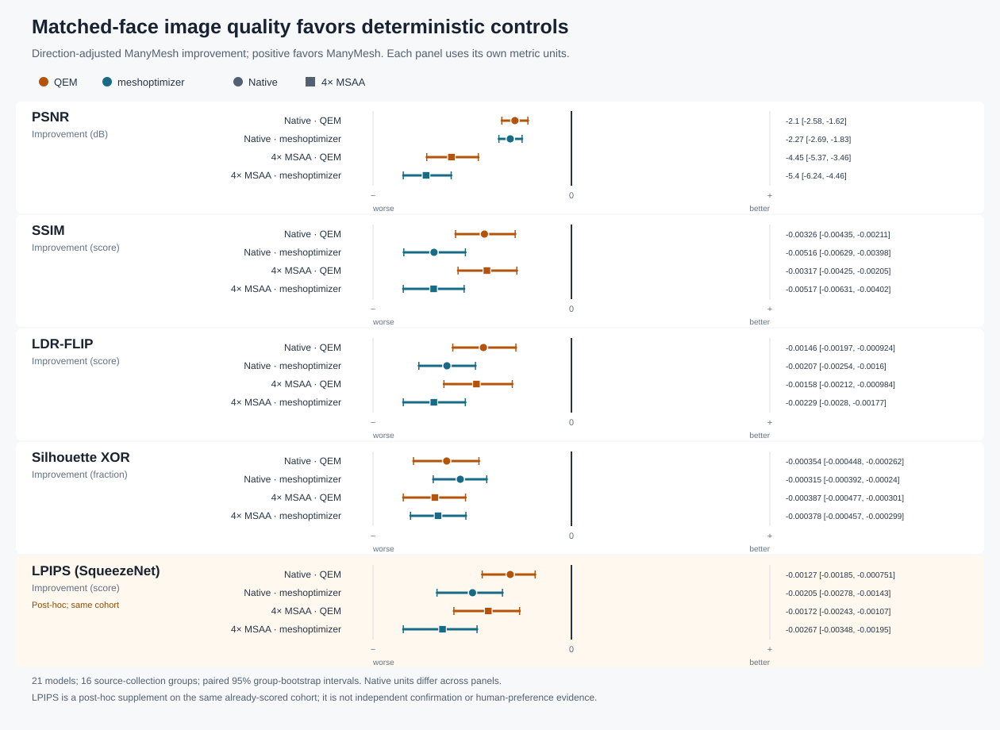

# ManyMesh

ManyMesh is a Filament-based research prototype for mesh level of detail
(LOD). It studies how simplified geometry affects image quality and rendering
cost. **No SIGGRAPH-ready method or mobile-performance result is established.**

## Research question

Can offline optimization improve a cluster-DAG mesh after a specified
antialiasing or upscaling pipeline, at matched face count and complete cost,
without breaking topology or cluster boundaries? This is an open experiment,
not a novelty claim. Differentiable mesh fitting and adaptive geometry LOD have
close prior art.

*Positive values favor ManyMesh; negative values favor the control. Each panel
uses its metric's native units. Primary metric bars show familywise 95%
simultaneous intervals over 16 source groups and 21 models. LPIPS shows an
individual interval for the post-hoc supplement on that same cohort. Data and
reproduction: [quality screen](tools/mmtrain/POLYHAVEN_QUALITY_SCREEN_20261124.md),
[multiplicity audit](tools/mmtrain/POLYHAVEN_MULTIPLICITY_AUDIT_20261125.md),
[plot script](tools/mmtrain/plot_polyhaven_multimetric.py).*

## Measured snapshots

- **21 models, 24 views each.** On Intel Iris Xe / D3D12 at 640 x 360, the
  50%-retention ManyMesh cut lost to border-preserving QEM and meshoptimizer on
  LDR-FLIP, PSNR, SSIM, and silhouette XOR, with native sampling and 4x MSAA.
  In the post-hoc LPIPS supplement, ManyMesh-minus-control deltas are +0.00127
  to +0.00267; all four 95% intervals favor the controls. This reuses the same
  cohort, not independent confirmation. A familywise max-t audit across the
  16 original endpoints leaves every 95% simultaneous interval favoring the
  controls. [Original protocol and results](tools/mmtrain/POLYHAVEN_QUALITY_SCREEN_20261124.md) ·
  [Multiplicity audit](tools/mmtrain/POLYHAVEN_MULTIPLICITY_AUDIT_20261125.md) ·
  [LPIPS supplement](tools/mmtrain/POLYHAVEN_LPIPS_SUPPLEMENT_RESULTS_20261125.md).
- **25.84%-34.75% silhouette-error share.** Source-referenced Monkey diagnostic
  across three face budgets and eight 192 x 192 views. One asset only; the
  historical 68.3% used a DAG cut as reference, not the original mesh.
  [Diagnostic and limits](tools/mmtrain/MONKEY_SOURCE_REFERENCE_DIAGNOSTIC_20261125.md).
- **3.93x raster-time speedup.** Stock meshoptimizer depth-2 geometry at
  10,000 BarramundiFish instances: 26.155 ms to 6.657 ms on Iris Xe / D3D12,
  1280 x 720, 4x MSAA. It submits 75% fewer triangles and has slightly worse
  image metrics. This is a reused single-asset desktop diagnostic, not a
  ManyMesh method or full-frame result.
  [Protocol and results](tools/mmtrain/INSTANCE_SCALE_BARRAMUNDIFISH_SCREEN_20261125.md).

## Evidence status

| Works in measured scope | Does not pass | Not measured |
|---|---|---|
| Fixed-view desktop quality and topology audits; post-hoc 21-model LPIPS and separate three-scene LPIPS/temporal diagnostics. | Current ManyMesh cuts lose to matched-face controls; prior contour-priority and contour-guided fitting screens show no repeatable gain. | Physical-phone performance, power, equal-frame-time quality, human preference, and a held-out optimized method with a validated temporal-quality gain. |

The moving-camera LPIPS screen uses three reused synthetic scenes and did not
establish an equal-time quality gain. The 21-model LPIPS supplement is
post-hoc on an already-scored cohort and is not independent confirmation.
Desktop evidence does not support mobile claims.
The 30-model Poly Haven confirmation set has frozen inputs and an evaluation
protocol, but remains unscored until the method configuration passes the
two-asset gate. Scoring is disabled in the manifest. This set tests a frozen
per-asset procedure on unseen assets, not cross-asset neural-model transfer.
[LPIPS and temporal results](tools/mmmetrics/MOVING_SCENE_EDGE_QUALITY_20261124.md) ·
[pool protocol](tools/mmtrain/POLYHAVEN_CONFIRMATION_POOL_20261125.md)
[Frozen confirmation protocol](tools/mmtrain/POLYHAVEN_CONFIRMATION_PROTOCOL_20261125.md)

## Next experiment gate

The frozen fixed-topology placement control has preflighted inputs for
BarramundiFish and Corset. It still needs CUDA for fitting and quality scoring;
the available host has CPU-only PyTorch. No fit result exists. A pass would
only open a separate asset-held-out cluster-DAG study, not establish
generalization or novelty.
[Protocol](tools/mmtrain/MATCHED_APPEARANCE_INPUTS_20261124.md) ·
[current status](MANYMESH.md)

## Research documents

- [SIGGRAPH 2027 direction](SIGGRAPH_2027_DIRECTION.md)
- [Prior-art screen](docs/manymesh/siggraph-prior-art-screen-20261123.md)
- [Next experiment gate](MANYMESH_NEXT_EXPERIMENT_GATE.md)
- [Dated experiment history](MANYMESH_HISTORY.md)
- [Filament documentation](filament/README.md)
