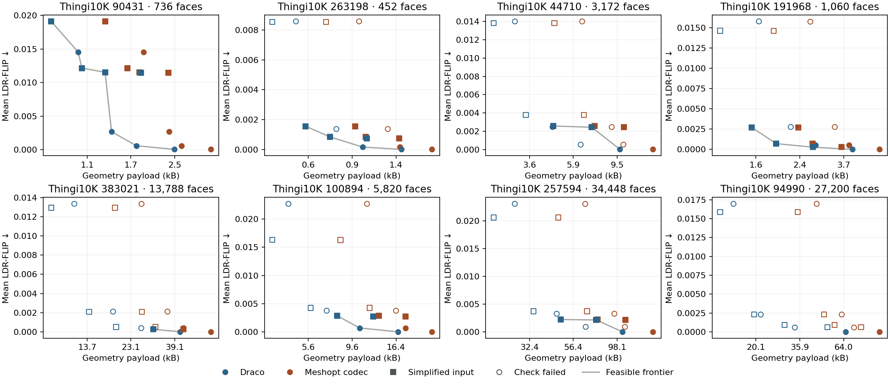

# Geometry codec rate and distortion

This development screen measures how many bytes it takes to store triangle meshes
at a given level of rendered distortion. It serves as a baseline for a future
decoder that ships its own geometry representation. Asset meshes come from the
eight validation models in the [hash-pinned Thingi10K pilot](THINGI10K_PILOT_DATA_20261120.md).

## Protocol

- Encode the full source mesh and a locked-border meshoptimizer simplification
  targeting 70% of the input faces. Keep every asset in the denominator.
- Compare vendored [Draco](https://github.com/google/draco) 1.5.7 Edgebreaker at
  encoder and decoder speed 5 with the vendored
  [meshoptimizer](https://github.com/zeux/meshoptimizer/tree/master/js) 0.18.1
  vertex and triangle codecs using vertex reorder for encoded size. Sweep 8, 11,
  14, and 20 bits per position coordinate. Both codecs use one uniform step for
  all three axes. Snap the bounding origin down and the range up to multiples of
  1/64 so Draco's decimal option serialization represents the same bounds.
- Count the whole Draco stream or both compressed meshoptimizer buffers plus
  the 32-byte meshoptimizer experiment header. The measured unit is one
  standalone geometry payload with positions and indices. It excludes materials,
  other vertex attributes, transport compression, and production container costs.
- Render decoded triangle buffers against the original mesh in eight orthographic
  views at 192x192 with 4x pixel sampling and flat shading. Report NVIDIA
  LDR-FLIP at 67 pixels per degree, PSNR from mean per-view MSE, Gaussian-window
  SSIM, silhouette XOR, and coverage MAE. Lower LDR-FLIP indicates less distortion.
- Audit the simplifier's directed boundary before encoding. Verify the decoded
  oriented triangle multiset on the shared integer grid, and check for degenerate
  and duplicate triangles and inconsistent or nonmanifold edges on both the grid
  and decoded coordinates. Draw rejected points with open markers. This audit
  covers independently encoded static meshes. Inter-cluster seam compatibility
  and self-intersections are outside the scope of these checks.
- Time 11 warm decodes per point on an Intel Core i7-13700H running Windows 11
  and Node.js 22.16.0. Decode time includes materializing float32 XYZ and uint32
  triangle buffers. Initialization, file I/O, rendering, and GPU upload are
  outside the timed interval.

## Results

All 128 configurations decoded and matched the expected oriented triangle
multiset on the shared quantization grid. The codecs produced the same topology
verdict at every paired setting. Paired LDR-FLIP differed by at most 0.000035
on the raw outputs and matched on all eight full meshes at 20 bits.



| Geometry | Bits | Passing assets, both codecs | Median bytes, Draco / meshopt | Median LDR-FLIP, Draco / meshopt | Median decode ms, Draco / meshopt |
|---|---:|---:|---:|---:|---:|
| Full | 8 | 1/8 | 3,756 / 8,984 | 0.015161 / 0.015144 | 1.97 / 1.05 |
| Full | 11 | 1/8 | 5,856 / 12,659 | 0.002569 / 0.002569 | 1.41 / 1.51 |
| Full | 14 | 4/8 | 8,444 / 14,277 | 0.000553 / 0.000553 | 1.76 / 1.44 |
| Full | 20 | 8/8 | 13,262 / 19,692 | 0.000015 / 0.000015 | 1.80 / 1.54 |
| Simplified | 8 | 1/8 | 3,042 / 6,546 | 0.015249 / 0.015241 | 1.79 / 0.65 |
| Simplified | 11 | 3/8 | 4,638 / 9,243 | 0.003209 / 0.003209 | 1.38 / 0.66 |
| Simplified | 14 | 6/8 | 6,354 / 10,351 | 0.001573 / 0.001572 | 1.18 / 0.81 |
| Simplified | 20 | 7/8 | 9,803 / 14,296 | 0.001454 / 0.001454 | 1.56 / 0.69 |

The medians include all eight raw outputs. The median decode cost across assets
uses each asset's median of 11 decodes. The byte-LDR-FLIP frontier in the figure
uses only settings that pass the checks. Its segments connect measured points.

Draco emitted fewer bytes in all 64 paired comparisons. On full meshes at 20
bits it saved a mean of **29.8%** relative to meshopt (95% paired asset-bootstrap
interval **[26.8%, 32.6%]**, 20,000 resamples), with identical measured LDR-FLIP.
Its warm decode took longer on five of those eight assets. At 14 bits only four
full meshes passed despite low median LDR-FLIP. Asset 94990's simplified input
already contained a degenerate triangle before encoding, so it failed the
simplified geometry check at all precisions.

The screen covers whole static STL meshes, the vendored codec versions, and
one packing scheme. It establishes a geometry payload baseline. A comparison
with a cluster decoder would also need to count the base mesh, weights, sidecar,
and metadata, measure complete load cost and memory, and verify inter-cluster
boundaries. See the [per-view and timing receipt](geometry_codec_rate_distortion_20261122.json).

## Reproduce

Use the [pilot download manifest](THINGI10K_PILOT_DATA_20261120.md) and the Python
environment for the [70% quality comparison](CLUSTER_DECODER_BASELINE_70PCT_VALIDATION_20261122.md),
including NumPy, Numba, SciPy, Pillow, fast-simplification, scikit-image,
flip-evaluator, and Matplotlib. Run from the repository root.

```powershell
python tools/mmtrain/bench_geometry_codecs.py --manifest out/thingi10k-metadata/meshes/download_manifest.json --out out/geometry-codecs/validation-aligned.json
python tools/mmtrain/summarize_geometry_codecs.py out/geometry-codecs/validation-aligned.json --plot tools/mmtrain/geometry_codec_rate_distortion_20261122.png
```
