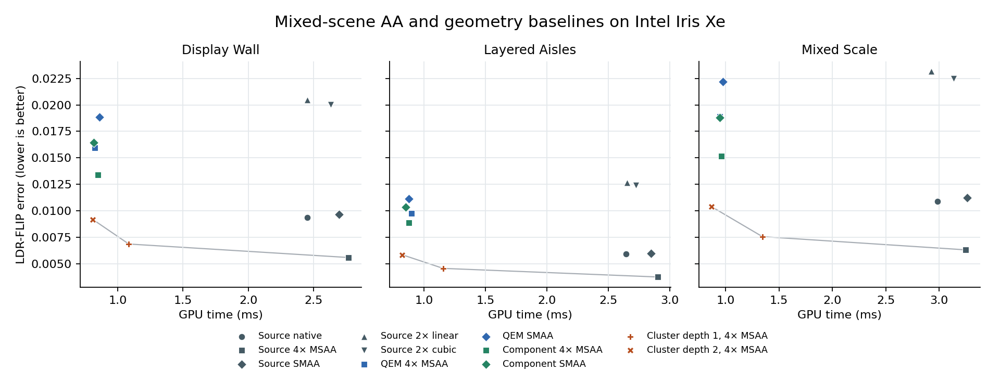

# Million-triangle mixed-scene baseline

This benchmark tests whether fixed-view AA and geometry comparisons transfer
from isolated repeated assets to a shared depth buffer with several mesh types
and occlusion. The output is a baseline for a future candidate.

## Frozen protocol

- Reuse the 13 pinned Khronos glTF meshes and their frozen QEM and component
  cuts. Use three deterministic arrangements, a mostly separated display
  wall, layered aisles, and mixed-scale foreground and background objects.
  Each arrangement must submit at least 1 million full-source triangles and
  contain at least five mesh types. Use three camera positions per arrangement.
- Render each arrangement at 1280×720 on Intel Iris Xe through D3D12. Submit
  one indexed instanced draw per asset and use a shared depth buffer. Use
  the same camera, mesh transforms, and gray directional shading in every
  mode. Render the source at 2560×1440 with 4× MSAA and downsample in linear
  light for the quality reference.
- Use native full source, full source with 4× MSAA and Bevy SMAA, and full
  source with half-resolution linear and Catmull–Rom upscaling. Compare QEM
  and component cuts with 4× MSAA and SMAA. Include upstream meshoptimizer
  cluster depth 1 and 2, each with 4× MSAA, where the stock demo can export
  its cut. Count submitted triangles for each mode and report face-budget
  differences. Measure GPU raster through the final pass, timing 3 batches
  of 24 frames after warm-up. Group comparisons by scene and camera.
- Report LDR-FLIP using the validated achromatic scorer, PSNR, SSIM, and
  foreground XOR, with per-view samples and a quality–time frontier. Record
  the pinned asset provenance, mesh hashes, camera poses, triangle counts,
  timestamps, and reference and candidate image hashes. A faster mode
  advances a frontier for a given metric if no measured equally fast or
  faster mode has equal or better quality. Camera views are repeated
  measures of the same development scenes and not independent samples.

## Workloads and results

All modes share the same offscreen renderer on Intel Iris Xe, driver
31.0.101.4502, with D3D12 and wgpu 0.33.0. The scene counts below are
submitted triangles, with no visibility culling. The overlap fraction counts
pixels covered by more than one asset group in separate native renders,
divided by the visible union. The union agrees exactly with native combined
frame coverage in all nine views. Groups use [pinned Khronos sample assets](https://github.com/KhronosGroup/glTF-Sample-Assets/tree/f0920f5b32d172a30efe3f9257e965918831e6ea)
under CC0 or CC BY 4.0, with source records in the receipt.

| Scene | Instances / mesh types | Source triangles | QEM or component triangles | Cluster 1 / 2 triangles | Across-asset overlap, across views |
|---|---:|---:|---:|---:|---:|
| Display wall | 35 / 7 | 1,790,695 | 358,110 | 895,050 / 446,865 | 0.0% |
| Layered aisles | 42 / 7 | 1,652,052 | 334,134 | 825,762 / 412,236 | 36.7–43.5% |
| Mixed scale | 48 / 8 | 2,145,318 | 432,468 | 1,070,616 / 534,624 | 5.5–6.9% |

The table reports medians across the three views per scene. Each cell shows
p50 GPU ms / LDR-FLIP. Lower values are better on both axes. The
[raw receipt](mixed_scene_baselines_720p_20261122.json) contains PSNR, SSIM,
foreground XOR, and 72 timestamp samples per mode and view. The figure shows
all modes and connects the scene-median frontier.



| Mode | Display wall | Layered aisles | Mixed scale |
|---|---:|---:|---:|
| Full source, native | 2.451 / 0.00936 | 2.644 / 0.00593 | 2.987 / 0.01089 |
| Full source, 4× MSAA | 2.768 / 0.00558 | 2.905 / 0.00375 | 3.247 / 0.00631 |
| Full source, SMAA | 2.694 / 0.00966 | 2.849 / 0.00595 | 3.263 / 0.01125 |
| Full source, linear 2× | 2.451 / 0.02049 | 2.655 / 0.01266 | 2.925 / 0.02315 |
| Full source, Catmull–Rom 2× | 2.633 / 0.02002 | 2.727 / 0.01243 | 3.134 / 0.02248 |
| QEM, 4× MSAA | 0.826 / 0.01596 | 0.899 / 0.00974 | 0.945 / 0.01891 |
| QEM, SMAA | 0.858 / 0.01882 | 0.878 / 0.01112 | 0.974 / 0.02218 |
| Component, 4× MSAA | 0.850 / 0.01341 | 0.877 / 0.00885 | 0.962 / 0.01518 |
| Component, SMAA | 0.815 / 0.01644 | 0.852 / 0.01034 | 0.945 / 0.01882 |
| Cluster depth 1, 4× MSAA | 1.085 / 0.00686 | 1.156 / 0.00456 | 1.344 / 0.00756 |
| Cluster depth 2, 4× MSAA | 0.808 / 0.00918 | 0.822 / 0.00584 | 0.868 / 0.01038 |

- At identical face counts, the component cut with 4× MSAA improves on QEM
  FLIP in 9/9 views, and both FLIP and p50 time in 6/9. It beats the
  full-source linear and cubic upscaling modes on both axes in 9/9.
- The stock depth 2 cut is faster and lower-FLIP than the QEM and component
  4× MSAA modes in every view, although it submits about 24–25% more
  triangles. In layered aisles its median PSNR / SSIM is 37.47 dB / 0.99336,
  versus 34.33 dB / 0.98865 for components and 38.97 dB / 0.99513 for full
  source, all with 4× MSAA. Its median GPU time is 0.822 ms versus 0.877 ms
  and 2.905 ms respectively.
- Both stock cuts and full-source 4× MSAA lie on the measured FLIP
  frontier in all nine views. Component SMAA is additionally on the frontier
  in one display-wall view because it is faster there. The layered result
  shows why beating upscaling or same-face QEM is insufficient evidence
  before comparing the stronger hierarchy.

## Controls and limitations

The [stock meshoptimizer v1.2 demo](https://github.com/zeux/meshoptimizer/tree/9d9890c73011d75920af614485296d1e03e95448/demo)
exports fixed depth cuts. Float positions and normals are restored from the
input vertex buffer after verifying depth 0 oriented faces and the stable
dumped vertex order. Every mode uses the same draw count for a scene.
Index order and vertex storage differ between the supplied cuts, so the timing
advantage describes these geometry streams. The [layout control](MIXED_SCENE_LAYOUT_CONTROL_20261122.md)
finds that applying common cache and vertex-fetch optimization reverses the
depth 2 speed advantage on all nine views while preserving its quality lead.

The receipt reports welded duplicate faces, repeated-vertex faces, boundary
edge counts, and nonmanifold edge counts in the stock cuts. Depth 2 adds
nonmanifold edges to CesiumMilkTruck, FlightHelmet, and StainedGlassLamp,
whose source exports had zero. The AntiqueCamera source already contains
nonmanifold edges. The rendering baseline includes these cases. A strict
topology-preserving comparison therefore still requires suitable inputs
and cut validation. The diagnostic counts do not prove topology equivalence
or check for self-intersections.

The synthetic scenes use rigid instances and gray normal-based shading.
The geometry coverage is roughly 8–11% of the native image, so all-frame
metrics are tied to these compositions. The comparison keeps the full
supersampled scene as reference. It measures the GPU pass interval with
resident buffers, including resolve, SMAA or upscaling where enabled.
CPU submission, runtime LOD selection, asset loading, presentation, and
peak memory require separate measurements. No mobile, user preference,
animation, or authored-material claim is supported.

## Reproduce

Use the [earlier SMAA setup](GPU_SMAA_SILHOUETTE_BAND_SCREEN_20261122.md#reproduce)
for the PLY exports, shader files, and Python environment and the
[stock demo setup](UPSTREAM_CLUSTERLOD_SCREEN_20261122.md#reproduce) for
the pinned executable. The source-list files are from the original
[multi-asset screen](CLUSTER_DECODER_GPU_MSAA_13ASSET_SCREEN_20261122.md).

```powershell
python tools/mmtrain/prepare_scene_clusterlod.py --manifest out/geometry-refinement-pilot/motion-96.json --meshes out/geometry-refinement-pilot/motion-meshes --upstream out/deps/meshoptimizer-v1.2 --out out/mixed-scene/stock
python tools/mmtrain/bench_mixed_scenes.py --manifest out/geometry-refinement-pilot/motion-96.json --meshes out/geometry-refinement-pilot/motion-meshes --stock out/mixed-scene/stock --shader-root out/deps/bevy-smaa --source-lists out/geometry-refinement-pilot/assets/sources.json out/geometry-refinement-pilot/holdout-assets/sources.json --out out/mixed-scene/baseline-720p.json --captures out/mixed-scene/captures
python tools/mmtrain/summarize_mixed_scenes.py out/mixed-scene/baseline-720p.json --out out/mixed-scene/summary.json --plot out/mixed-scene/frontiers.png
```
